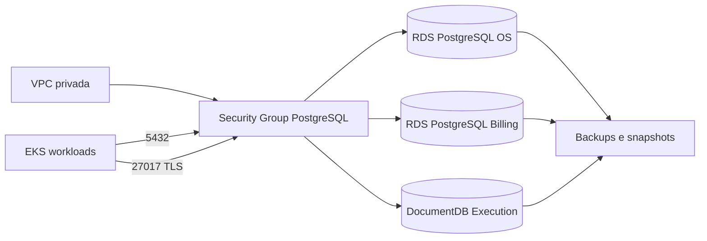

# Garage Management Database

Repositorio Terraform da persistência gerenciada dos microsserviços do Garage
Management.

## Repositorios da solucao

- [OS Service](../garage-management-os-service)
- [Billing Service](../garage-management-billing-service)
- [Execution Service](../garage-management-execution-service)
- [Lambda de autenticacao](https://github.com/kmlyteixeira/garage-management-lambda)
- [Infraestrutura EKS/API Gateway](https://github.com/kmlyteixeira/garage-management-infra)
- [Infraestrutura RDS PostgreSQL](https://github.com/kmlyteixeira/garage-management-database)

## Escopo e limite

Provisiona dois RDS PostgreSQL 16 privados, um para o OS Service e outro para
o Billing Service, e um cluster Amazon DocumentDB compatível com MongoDB para o
Execution Service. Cada serviço mantém seu schema lógico; este repositório
provisiona apenas a infraestrutura física, rede, backups e outputs.

O banco legado do `api-dotnet` deve permanecer em um state/ambiente separado
durante a transição. Não reutilize o mesmo database lógico dos microsserviços.

## Arquitetura



## Modelo e consistencia

Cada microsserviço mantém seu modelo lógico e suas migrações/evolução de schema.
Este repositório não contém entidades nem migrations de aplicação.

## Variaveis Terraform

Obrigatórias: `vpc_id`, `private_subnet_ids`, `api_security_group_id`,
`workload_security_group_ids`, `os_db_password`, `billing_db_password` e
`execution_db_password`. O restante possui defaults documentados em
`variables.tf`:

```bash
terraform init
terraform plan \
	-var='environment=homologacao' \
	-var='vpc_id=vpc-0123456789abcdef0' \
	-var='private_subnet_ids=["subnet-0123456789abcde01","subnet-0123456789abcde02"]' \
	-var='api_security_group_id=sg-0123456789abcdef0' \
	-var='os_db_password=...'
	-var='billing_db_password=...'
	-var='execution_db_password=...'
```

As senhas são valores aleatórios de exemplo apenas para desenvolvimento e nunca
devem ser reutilizadas. Em CI/CD, injete os três `TF_VAR_*_db_password` por
secrets externos. Para produção, use Secrets Manager/rotação e
`multi_az=true`.

O arquivo [production-secrets.example.env](production-secrets.example.env)
mostra os nomes esperados das variáveis sem conter credenciais reais.

## Defaults e operacao

- Engine PostgreSQL 16, classe `db.t3.micro`, 20 GiB gp3 com crescimento ate 100 GiB.
- `publicly_accessible=false`, acesso somente pela rede privada e security group da API.
- Backup automatico de 7 dias, criptografia em repouso, snapshot final e `deletion_protection=true`.
- `multi_az=false` por custo em desenvolvimento; habilitar em homologacao/producao conforme SLA.

```bash
terraform fmt -check -recursive
terraform validate
terraform plan -out=tfplan
terraform apply tfplan
terraform output
```

## CI/CD e seguranca

- `terraform.yml` executa fmt/validate/plan em Pull Requests.
- `apply.yml` carrega VPC, subnets e security group do SSM publicado pelo
  `garage-management-infra` e aplica somente no `master`.
- Os endpoints e strings de conexão são publicados como parâmetros
  `SecureString` no SSM para consumo pelos microsserviços.
- `master` e a branch de apply do AWS Academy; o state usa S3.
- Nunca versionar senha, `.tfvars` real, dumps ou dados pessoais. Restrinja IAM e registre auditoria no CloudTrail.

## GitHub Environment `aws-lab`

Configure no repositório:

- Variable `AWS_REGION`, por exemplo `us-east-1`.
- Variable `TERRAFORM_ENVIRONMENT`, com o mesmo valor usado no `infra`.
- Variable `TF_STATE_BUCKET`, igual ao configurado no `infra`.
- Secrets `AWS_ACCESS_KEY_ID`, `AWS_SECRET_ACCESS_KEY` e `AWS_SESSION_TOKEN`.
- Secrets `OS_DB_PASSWORD`, `BILLING_DB_PASSWORD` e
  `EXECUTION_DB_PASSWORD`.

O workflow busca automaticamente no SSM os parâmetros publicados pelo
`garage-management-infra`. O apply do banco deve ocorrer depois do apply da
plataforma.

## Observabilidade e recuperacao

Monitore CPU, memoria, conexoes, storage, IOPS, latencia, erros de conexao e eventos de failover no CloudWatch. Crie alarmes para storage acima de 80%, conexoes acima do limite, replica lag quando aplicavel e falha de backup. Teste restauracao a partir de snapshot periodicamente e documente RPO/RTO por ambiente.

## Cenário local

O cenário local não usa Terraform nem AWS. Ele sobe os mesmos limites de
persistência dos serviços com Docker Compose:

```powershell
docker compose -f docker-compose.local.yml up -d
.\scripts\validate-local.ps1
docker compose -f docker-compose.local.yml down
```

Conexões locais:

```text
OS:        Host=localhost;Port=5432;Database=os_service;Username=garage;Password=garage
Billing:   Host=localhost;Port=5433;Database=billing_service;Username=garage;Password=garage
Execution: mongodb://localhost:27017/execution_service
```

## Produção

O ambiente de produção exige:

- duas subnets privadas em zonas distintas;
- `workload_security_group_ids` contendo o security group dos nodes/workloads do
  EKS;
- `multi_az=true` para PostgreSQL;
- `docdb_instance_count >= 2`;
- três secrets independentes;
- rotação por Secrets Manager ou mecanismo equivalente;
- TLS para a conexão do Execution Service ao DocumentDB.

Outputs principais:

- `os_db_endpoint`;
- `billing_db_endpoint`;
- `execution_db_endpoint`;
- `execution_db_reader_endpoint`;
- `database_security_group_id`.

## Entrega

- [API, Swagger e migrations](https://github.com/kmlyteixeira/garage-management-api-dotnet)
- [Plataforma EKS/API Gateway](https://github.com/kmlyteixeira/garage-management-infra)
- [Lambda de autenticacao](https://github.com/kmlyteixeira/garage-management-lambda)
