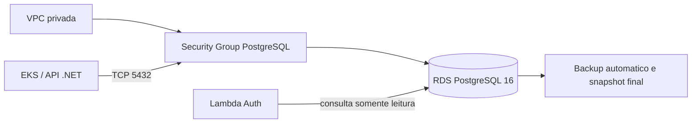

# Garage Management Database

Repositorio Terraform do banco gerenciado PostgreSQL do Garage Management.

## Repositorios da solucao

- [API principal, DbContext e migrations](https://github.com/kmlyteixeira/garage-management-api-dotnet)
- [Lambda de autenticacao](https://github.com/kmlyteixeira/garage-management-lambda)
- [Infraestrutura EKS/API Gateway](https://github.com/kmlyteixeira/garage-management-infra)
- [Infraestrutura RDS PostgreSQL](https://github.com/kmlyteixeira/garage-management-database)

## Escopo e limite

Provisiona RDS PostgreSQL 16 privado, subnet group com pelo menos duas zonas, security group restrito a origem da API, armazenamento criptografado, backups automaticos, crescimento de storage, snapshots finais, tags e protecao contra delecao. O DbContext, modelo relacional, DbMigrator e migrations EF Core permanecem na [API principal](https://github.com/kmlyteixeira/garage-management-api-dotnet/tree/main/src/GarageManagement.EntityFrameworkCore); este repositorio nao duplica schema.

## Arquitetura



## Modelo e consistencia

O modelo de negocio e mantido pelo EF Core e documentado em [ER model](https://github.com/kmlyteixeira/garage-management-api-dotnet/blob/main/docs/architecture/er-model.puml). As principais relacoes sao Cliente-Veiculo, Cliente-OrdemDeServico, OrdemDeServico-Orcamento, OrdemDeServico-Item e Item-Peca/Servico. Chaves estrangeiras, enums de status, indices para consulta publica e transacoes de abertura/aprovacao protegem consistencia; o DbMigrator aplica alteracoes versionadas antes da API iniciar.

## Variaveis Terraform

Obrigatorias: `vpc_id`, `private_subnet_ids`, `api_security_group_id` e `db_password`. O restante possui defaults documentados em `variables.tf`:

```bash
terraform init
terraform plan \
	-var='environment=homologacao' \
	-var='vpc_id=vpc-0123456789abcdef0' \
	-var='private_subnet_ids=["subnet-0123456789abcde01","subnet-0123456789abcde02"]' \
	-var='api_security_group_id=sg-0123456789abcdef0' \
	-var='db_password=Gm9!rT4#vQ7@pL2'
```

A senha e um valor aleatorio de exemplo para desenvolvimento e nunca deve ser reutilizada. Em CI/CD, injete `TF_VAR_db_password` por secret externo. Para producao, use Secrets Manager/rotacao e `multi_az=true`.

## Defaults e operacao

- Engine PostgreSQL 16, classe `db.t3.micro`, 20 GiB gp3 com crescimento ate 100 GiB.
- `publicly_accessible=false`, acesso somente pela rede privada e security group da API.
- Backup automatico de 7 dias, criptografia em repouso, snapshot final e `deletion_protection=true`.
- `multi_az=false` por custo em desenvolvimento; habilitar em homologacao/producao conforme SLA.

```bash
terraform fmt -check -recursive
terraform validate
terraform plan -out=tfplan
terraform apply tfplan
terraform output
```

## CI/CD e seguranca

- `terraform.yml` executa fmt/validate/plan em Pull Requests.
- `apply.yml` aplica mudancas com aprovacao do Environment e credenciais AWS protegidas/OIDC.
- `main`/`master` e protegida, sem commits diretos; merge por Pull Request aprovado e checks obrigatorios.
- `develop` e homologacao; `main` e producao, com state remoto e workspace separados.
- Nunca versionar senha, `.tfvars` real, dumps ou dados pessoais. Restrinja IAM e registre auditoria no CloudTrail.

## Observabilidade e recuperacao

Monitore CPU, memoria, conexoes, storage, IOPS, latencia, erros de conexao e eventos de failover no CloudWatch. Crie alarmes para storage acima de 80%, conexoes acima do limite, replica lag quando aplicavel e falha de backup. Teste restauracao a partir de snapshot periodicamente e documente RPO/RTO por ambiente.

## Entrega

- [API, Swagger e migrations](https://github.com/kmlyteixeira/garage-management-api-dotnet)
- [Plataforma EKS/API Gateway](https://github.com/kmlyteixeira/garage-management-infra)
- [Lambda de autenticacao](https://github.com/kmlyteixeira/garage-management-lambda)
